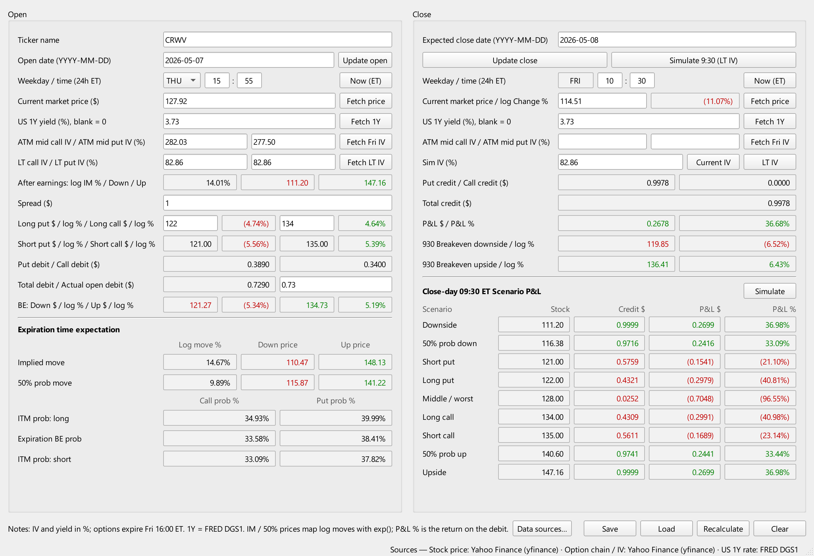
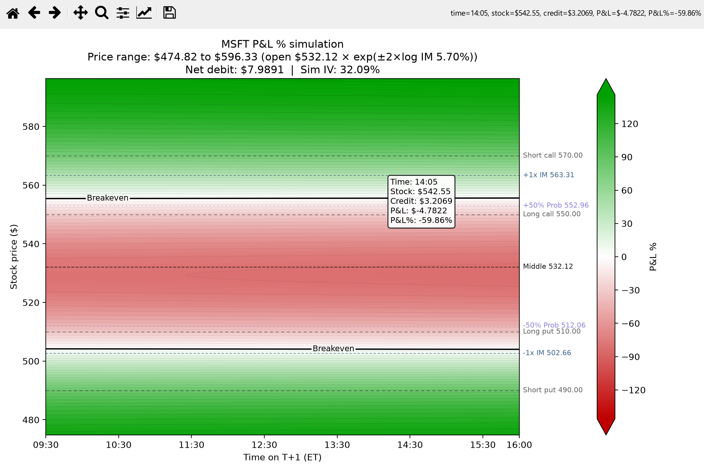

# Earnings Option Spread Calculator

### Model your P&L before you trade.

See the earnings move the options imply, your breakevens, and what the position is worth
at every stock price and every minute of the close day, before you open it.

A Windows desktop calculator (PyQt6) for trading a **long iron condor around an earnings
report**. Before the report you buy a put spread below the price and a call spread above
it, then sell both after the stock has moved, usually the next morning.



*The screenshots show a real trade: CRWV earnings in May 2026. It was opened Thursday
at 15:55 for a 0.73 debit and closed Friday at about 10:30 with the stock at 114.51. At
that exit the model, using the LT IV as Sim IV, shows a 0.998 credit (+36.7%). The actual
fill was 0.95 (+30.1%): the bid/ask on the deep in-the-money put spread cost the rest.
The close-side IV wasn't recorded, so those boxes are empty.*

## What it does

**Open side (left)**

- **Update open** fills in the date, the time (ET), the stock price, the US 1Y rate and
  this Friday's ATM call/put IV in one click. **Fetch LT IV** reads a 9–12-month
  quarterly ATM IV as the "normal", non-earnings volatility.
- **After earnings: log IM** is the implied earnings move (front-week IV minus normal
  IV), with the prices one move down and up.
- **Strikes:** you enter the spread width and the long put/call strikes. The app fills
  in the short strikes and each strike's distance from the price as a log %.
- **Debit:** the theoretical put, call and total debit. You can type your actual fill;
  if you do, it is used everywhere instead of the theoretical one.
- **Breakevens** at expiry.
- **Expiration time expectation:** the expected move to Friday, the 50%-probability
  band, and the probability of finishing in the money at the long strikes, short strikes
  and breakevens.

**Close side (right)**

- **Expected close date** sets when you plan to exit. It defaults to the trading day
  after the open, but can be any weekday from the open date up to that week's Friday,
  when the options expire. The weekday box follows the date; it shows `n/a`, and the
  close side stays blank, when the date can't be used.
- **Update close** marks the position now: today's date, the time, price, rate and
  current ATM IV, which it also copies into Sim IV. **Simulate 9:30 (LT IV)** sets up the
  usual exit instead: 09:30 on the expected close date, priced with the normal IV.
- **Sim IV** is the one IV used to price the close. The **Current IV** and **LT IV**
  buttons copy those values in, or you can type any number.
- **Results:** put/call/total credit, P&L in $ and %, and the stock prices where the
  09:30 P&L breaks even.
- **Close-day 09:30 scenario table:** credit and P&L at the implied-move prices, the
  50%-probability prices, each strike, and the middle.

**Simulate** opens a P&L % map over the close day (09:30–16:00) and a price range of ±2
implied moves. It marks the breakevens and the strike, implied-move and 50% lines.
Hovering shows the exact numbers; clicking opens price and time slices through that
point.



**Also:**

- Data comes from swappable sources (yfinance, Cboe, FRED), picked under **Data
  sources…**.
- Fetches run in the background, so the window never freezes.
- **Save** writes `data/YYYYMMDDTICKER.json` and **Load** reads one back. The last
  session is restored automatically.

## Run

```powershell
powershell -ExecutionPolicy Bypass -File .\run.ps1
```

(or right-click `run.ps1` → *Run with PowerShell*).

On the first run, `run.ps1` creates a private environment in `.venv` and installs
`requirements.txt`. To build it, the script uses the interpreter you pass with
`-Python`. If you don't pass one, it looks for Python 3.10+ from the `py` launcher or
on `PATH`. Failing that, it uses conda/miniforge (Python 3.12). Later runs only
reinstall when `requirements.txt` changes.

| Option                          | Effect                                           |
| ------------------------------- | ------------------------------------------------ |
| `-Python C:\path\to\python.exe` | build `.venv` from this interpreter              |
| `-Reinstall`                    | delete and rebuild `.venv`                       |
| `-SetupOnly`                    | prepare the environment without starting the GUI |

Without the script: `pip install -r requirements.txt`, then `python main.py`.

**Tests** run offline in a few seconds and never touch your data or settings:
`.venv\python.exe -m unittest` from the repo root (or `.venv\Scripts\python.exe` for a
venv-built `.venv`). GitHub Actions runs them on Windows with Python 3.12 on every push
and pull request (`.github/workflows/tests.yml`).

## How it works

**Pricing.**

- Black–Scholes for European options, all expiring Friday 16:00 ET.
- Time is the calendar time from the weekday and time boxes to Friday 16:00, in a
  365-day year.
- r is the US 1Y yield (a blank box means 0).
- The debit uses the open price and time: the put spread at the ATM put IV, the call
  spread at the ATM call IV.
- The credit uses the close price, the weekday of the expected close date and the close
  time, with **Sim IV** on every leg.
- P&L = credit − debit; P&L % is the return on the debit.

**Implied earnings move.**

- Front-week variance = normal variance + earnings variance, over the same time to
  expiry T:
  - event variance = (ATM IV² − LT IV²) · T
  - IM = √(event variance)
- IM is a log move, so its prices are S·e^(±IM), and the 50% band is S·e^(±0.6745·IM).
- The panel and the Simulate plot use the same formula.

**Expiration expectation.**

- The move to expiry is ATM IV·√T.
- Probabilities are risk-neutral: N(d2) for calls, N(−d2) for puts.

**IV from option quotes alone.** The stock price is not used to read IV. The method has
four steps:

1. Pick the strike where the call and put mids are closest, as in Cboe's VIX method.
2. Add the neighbouring strike on the other side of the forward.
3. Put–call parity on those one or two strikes gives the forward,
   F = K + e^(rT)·(C − P).
4. Solve call and put IV with Black–76 at each strike and interpolate them to F.

Dividends, borrow cost and quote delay are all inside F, so a delayed option feed doesn't
push call and put IV apart.

**LT IV** uses the 9–12-month quarterly expiry and is strict: it uses only bid/ask mids
with spreads up to 60%, requires some volume or open interest, and checks that the IV is
plausible and call and put agree. It also requires the implied stock price F·e^(−rT) to
be within 10% of the price in the box. Otherwise it reports an error instead of guessing.

**After the close.** Outside regular hours, with either source, the option quotes are the
last session's final ones. Time to expiry is then pinned to the options' last tradable
moment: that day's latest option trade, not before 16:00 and not after 16:15. That is
16:00 for stock options, about 16:15 for ETF and index options such as SPY, and 16:00
when there is no trade time.

Regular hours are judged from the delayed data's own time, so 09:30–09:45 still counts
as pre-market. Holidays count as closed. The status bar shows the strikes, F and any
pinned time.

## Known issues

- **Free data is about 15 minutes delayed** (both yfinance and Cboe):
  - An open at 15:55 sees the 15:40 quotes.
  - Until about 09:45 on the close morning, you still see the previous close.
  - For live marks, add a real-time source such as a broker API (see below).
- **Model simplifications:**
  - The debit and credit use one IV per side for all four legs. Real wing prices include
    skew, so the theoretical debit differs from the market; type your actual fill.
  - Listed equity options are American, but the model is European.
  - Dividends are ignored in the debit/credit (a few days to expiry).
- **The close is only as good as Sim IV.** The post-earnings IV is an assumption. LT IV
  is a common choice, not a forecast.
- **Edge cases:**
  - The pre-market path of the after-close pinning has only been tested with constructed
    timestamps.
  - Early-close days (13:00) are still pinned at 16:00.
  - Market holidays aren't known when the default close date is picked: it's simply
    the next weekday, so change it yourself around holidays.
  - On Friday after the close, this week's options have expired, so **Fetch Fri IV**
    reports an error.
- **LT IV may refuse thin names.** It rejects wide, dead or inconsistent quotes, for
  example hard-to-borrow stocks after hours.
- **Unofficial data sources:** yfinance scrapes Yahoo, and the Cboe endpoint is the
  undocumented feed behind cboe.com's pages. Either can change or rate-limit without
  notice.
- **Windows only:** `run.ps1` is for Windows. The Python code itself is portable, but it
  has only been run on Windows.

This is a calculator, not investment advice.

## Replaceable modules

Click **Data sources…** to pick a source separately for the stock price, the option chain
and the US 1Y rate. The choice is saved in `settings.json` (git-ignored).

| Source                   | Provides             | Notes                                                              |
| ------------------------ | -------------------- | ------------------------------------------------------------------ |
| Yahoo Finance (yfinance) | price, option chain  | free, no key; near-live stock price, option quotes ~15 min delayed |
| Cboe delayed quotes      | price, option chain  | free, no key; stock and options ~15 min delayed                    |
| FRED DGS1                | US 1Y Treasury yield | free, daily                                                        |

To add a source, for example a broker or paid real-time feed:

1. Create `ironcondor/providers/<name>.py` with a class that inherits `PriceSource`,
   `OptionSource` and/or `RateSource` from `ironcondor/providers/base.py`. Give the
   class a `key`, a `label` and a `description`.
2. Add `register(YourSource)` at the bottom of `ironcondor/providers/registry.py`.
3. Put constructor arguments such as API keys in `settings.json`:
   `{"provider_options": {"<key>": {"api_key": "..."}}}`.

The calculator and the GUI only see the normalized `OptionChain` / `OptionQuote` model,
so nothing else changes. A source can mark a closing snapshot with `OptionChain.quote_time`
to get the after-close time pinning.

## Layout

```
.github/workflows/        CI: runs the tests on every push and pull request
main.py                   entry point
run.ps1                   environment setup + launcher
requirements.txt
docs/                     README screenshots
tests/                    offline unittest suite (golden values from real trades, IV method,
                          session timing, save-file migration, data-source parsing, GUI)
tools/
  render_screenshots.py   re-renders docs/*.png from the CRWV example trade
                          (offscreen; leaves your cache and settings alone)
ironcondor/
  core/                   pure math, no GUI or network
    blackscholes.py         pricing, ITM probability, IV solver
    calculator.py           every output on the main window
    simulation.py           P&L surface for the Simulate plot
    atm_iv.py               expiry choice + IV from option quotes
    strategy.py             spread credit, breakeven search
    timeutils.py            ET clock, time to expiry, trading-session rules
    numbers.py              input parsing, number formats
  providers/              data sources (yfinance, Cboe, FRED) + registry
  services.py             routes each request to the chosen source
  actions.py              what each fetch button does (no GUI code)
  storage.py              save files, auto-restore cache, settings
  gui/                    PyQt6 windows (main window, Simulate plot, data-source dialog)
data/                     your saved trades and _cache.json (git-ignored)
```

To refresh the screenshots after changing the UI, run `.venv\python.exe tools\render_screenshots.py`.
If `.venv` was built from a standalone Python, use `.venv\Scripts\python.exe` instead.
